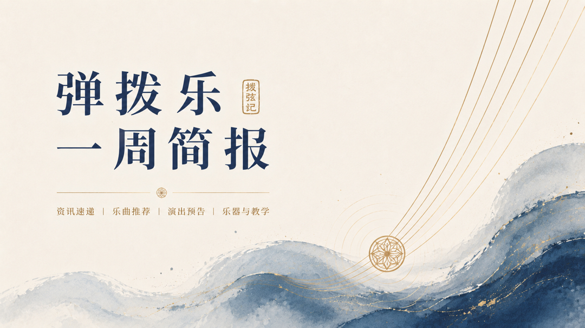

# 弹拨乐一周简报
## （2026.10.11—10.17）

## 编辑导语

> 本周弹拨乐舞台国际交流频繁。纽约联合国总部以五弦琵琶为主的国乐快闪、北京中俄学术周上柳琴与巴拉莱卡同台；香港Joy of Music Festival迎来Alvaro Pierri，阿努什卡·香卡西塔琴中国三城巡演进入收官。欧洲方面，塞维利亚吉他节继续纪念法雅诞辰150周年，蒙彼利埃国际吉他艺术节结束后，图卢兹制琴沙龙接续展开。上周第13届ARTE国际曼陀林音乐节赛果公布，以色列选手Dor Amran获得双冠。接下来一周，URI吉他与曼陀林音乐节、伦敦国际吉他音乐节杨雪霏专场、阿努什卡·香卡广州演出等值得关注。

---

## 近期重要演出






  
  - **🎫 {{ event.date }}｜{{ event.city }}**｜[查看详情]({{ event.link }})  
  **{{ event.title }}**
  


更多近期演出：**《拨弦记》演出情报**
[https://boxianji.guitarkk.com/attention/](https://boxianji.guitarkk.com/attention/)

---

## **艺术节、赛事与学术动态**

- **第13届ARTE国际曼陀林音乐节与比赛赛果公布（上周补报）。** 以色列选手Dor Amran获曼陀林独奏组（Category A）第一名，德国选手Jolina Beuren获第二名；曼陀拉、曼陀切洛及现代鲁特琴组（Category B）第一名同为Dor Amran（官网拼写存在Amran/Arman差异，发布前宜再核对），日本选手牛尾絵梨香（Erika Ushio）获第二名；日本演奏家宫泽博之（Hiroyuki Miyazawa）获作曲家川上统特别奖。

- **第17届塞维利亚吉他节持续至11月7日。** 本届主题为“法雅的梦想吉他”，纪念曼努埃尔·德·法雅诞辰150周年，古典与弗拉门戈并行。本周有Lucía Reyes古典吉他独奏、Filip Mišković（安德烈斯·塞戈维亚比赛获奖者）免费入场独奏；10月18日中国青年吉他家范世龙将演奏阿萨德、格拉纳多斯及法雅的作品。

- **第31届蒙彼利埃国际吉他艺术节结束，图卢兹沙龙接续。** 10月17—18日在图卢兹La Cité举办国际吉他沙龙，有百余位制琴师与展商参与，设试琴、大师课（含Édith Pageaud古典吉他）、现场制琴演示及低票价音乐会，免费入场。

- **第11届URI吉他与曼陀林音乐节将于10月18—25日举行。** 由罗德岛大学主办，邀请Jorge Caballero、Eliot Fisk、Antoine Boyer与Yeore Kim、Jacob Reuven等三十余位演奏家，涵盖古典、爵士、布鲁斯与巴西音乐，安排比赛、音乐会、大师班及大型合奏。同期10月22—25日举办新英格兰制琴师展，北美制琴师展示乐器，并设Instrument Showcase，由音乐节艺术家现场试奏。

- **第21届西班牙比维拉琴、鲁特琴与吉他学会年会将于10月24—25日在昆卡举行。** 围绕西班牙文艺复兴时期音乐传统展开研究与演奏交流。

- **第11届马德拉国际曼陀林音乐节将于10月23—25日举行。** 当地曼陀林团体与国际嘉宾共同参与，后续演出安排延续至11月。

- **2026中俄教育年当代音乐创作学术活动周在北京举行。** 由中央音乐学院主办，圣彼得堡国立音乐学院师生参加。专场音乐会上，柳琴与巴拉莱卡琴合作演出，并共同演奏原创巴扬协奏曲《满江红》。

---

## **乐器制作、非遗与文化动态**

- **联合国总部举行中国传统民乐快闪。** 联合国中国书会与方锦龙国乐联合主办“大乐同和·国乐礼赞”，以五弦琵琶为主，结合吹管、民族舞蹈与川剧变脸，曲目包括《十面埋伏》《丝路行》等，并现场展示贾湖骨笛等古代乐器。方锦龙作为当代五弦琵琶代表人物主导演出并讲解乐器。

- **上海国际乐器展（Music China）将于10月28—31日举行。** 地点在上海新国际博览中心，覆盖民族弹拨全产业链，预计有千余家展商，含传统工艺与音乐科技展区。观众预登记免费通道已开启。

- **巴林国际音乐节“Oud Night”上演。** 第35届巴林国际音乐节中，巴林乌德演奏家Mohammed Al Bakri与中国乌德演奏家Dr. Joo Zhao（中央音乐学院民族音乐学博士，曾修习琵琶）同台演出。

---

## **行业动态**

- **阿努什卡·香卡《Chapters Tour》中国巡演进入收官。** 10月14日北京保利剧院、10月16日上海东方艺术中心之后，10月18日将在广州星海音乐厅举行收官场，纳入2026广州爵士音乐季。编制包括西塔琴、单簧管、低音提琴与打击乐，曲目以个人原创为主。

- **第29届北京国际音乐节进行中。** 至10月20日共12场演出，阿努什卡·香卡西塔琴专场已上演，与伦敦爱乐乐团、崔健等共同构成节目安排。

- **香港Joy of Music Festival 2026持续。** 乌拉圭古典吉他家Alvaro Pierri于10月16日在香港大会堂演奏Piazzolla、Albéniz、Ginastera等作品，并举办公开大师课；同期有Ponpon陈芃瑄爵士五重奏。

- **10月24日深圳音乐厅将举办“音乐下午茶：爱的罗曼斯”古典吉他音乐会。** 深圳赋格吉他乐团及多位吉他演奏者参加，微信抢票时间为10月22日中午12时。

- **伦敦国际吉他音乐节（IGF）10月24—25日安排杨雪霏专场。** 10月24日独奏音乐会曲目涵盖中国传统音乐、西班牙作品及现代吉他经典，其中陈怡《故乡梦》（Dreaming of my Hometown）将有重要呈现；10月25日举办古典吉他大师班，提供演奏者参与及旁听机会。

---

## **人物资讯**

- **范世龙参加第17届塞维利亚吉他节。** 10月18日将演奏阿萨德、格拉纳多斯及法雅等作品。

- **雅曼杜·科斯塔（Yamandu Costa）将于10月21日在巴塞罗那与安德烈娅·莫蒂斯（Andrea Motis）合作。** 在巴塞罗那国际爵士音乐节上呈现七弦吉他、小号与人声的合作演出。

- **吉炜于北京正乙祠戏楼举行《和合之美》筝乐会。** 10月17日，中央音乐学院教授吉炜携合作者演出，曲目包括《春江花月夜》《渔舟唱晚》《夜深沉》及当代作品。