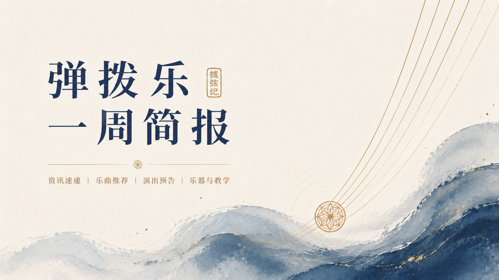

# 弹拨乐一周简报
## （2026.11.08—11.14）

## 编辑导语

> 本周国际吉他节：图宾根第二周末、圣雷莫闭幕、Jüchen决赛与奥尔堡开幕同步举行，Miquel Llobet决赛在即。国内“弦弹西东”竖琴古筝巡演完成杭州、广州、厦门场次，冯满天阮咸即兴、匡泓霖琵琶独奏、武怀琛古琴专场与煤矿文工团弹拨专场同期举行。Ozielzinho亚洲巡演进入港澳新马印尼段，Marcin Patrzałek发布电吉他新单曲。日本弦乐器制作者协会主办的第65回弦乐器展于11月7—8日在东京九段会馆举行。未来一周至月底，布鲁塞尔、普列文吉他节及多场亚洲场次值得持续关注。

---

## 近期重要演出






  
  - **🎫 {{ event.date }}｜{{ event.city }}**｜[查看详情]({{ event.link }})  
  **{{ event.title }}**
  


更多近期演出：**《拨弦记》演出情报**
[https://boxianji.guitarkk.com/attention/](https://boxianji.guitarkk.com/attention/)

---

## **艺术节、赛事与学术动态**

- **德国图宾根国际吉他节（主题Raíces）第二周末（11月13—15日）进行中。** 活动涵盖古典吉他、弗拉门戈、爵士、拉丁美洲音乐、室内乐及交响乐，设公开舞台、国际吉他比赛、获奖者音乐会、午间音乐会与闭幕音乐会。11月14日Classic Talent国际吉他比赛在Tübinger Musikschule举行，11月15日迎来闭幕。

- **第12届圣雷莫国际吉他节与比赛（11月10—14日）在Sanremo Casino Theatre举行。** 艺术总监Diego Campagna。本周场次包括11月13日陈川、Hee-Young Lim与Kroma Guitar Quartet，以及Lorenzo Micheli与Vera Danilina的合作；11月14日Eliot Fisk与圣雷莫交响乐团及GuitarDUO（Srdjan Bulatović、Darko Nikčević）完成闭幕演出。每日另设Rêve Bistrot的Sanremo Guitar Experience交流演出。

- **第10届Jüchen国际吉他节（11月13—15日）举行。** 内容包括国际比赛、青年组比赛、大师班、音乐会及乐器展览。11月13日开幕并启动预赛与大师班，11月14日继续预赛与青年组，11月15日在Schloss Dyck举行决赛、颁奖与闭幕音乐会。

- **第29届奥尔堡吉他节与比赛（11月14—22日）开幕。** 涵盖古典、现代、爵士、布鲁斯、弗拉门戈及民间音乐，安排音乐会、比赛、工作坊与吉他博览会。11月14日Aalborg Culture School’s Guitarday免费入场，11月15日Ensemble Zimmerman开幕音乐会，19—21日比赛，21—22日吉他博览会。

- **Miquel Llobet国际吉他比赛决赛11月15日18:30在巴塞罗那举行。** 三位入围者Gian Carlo Scevola（智利）、Ezequiel Alberto Suárez（阿根廷）、Álvaro Guerra（西班牙）将与Brossa Quartet合作演出。赛事纪念曼努埃尔·德·法雅诞辰150周年，一等奖奖金3000欧元，二等奖2000欧元，三等奖1000欧元。

- **第21届Nikšić国际吉他比赛职业组报名已于11月13日截止。** 11月21日线上首轮（视频在音乐节YouTube与Facebook播出），12月13日在RTV Nikšić演播室举行现场决赛并直播。首轮与决赛均须背谱，曲目不可重复。一等奖为价值4000欧元的Dimitris Piperidis制作吉他。

- **Hanse Guitar Festival（汉堡，11月5—8日）已结束。** 第12届汉堡吉他节首次以Hanse Guitar Festival名称举办，地点Kulturhof Dulsberg。内容包括多风格音乐会、工作坊、讲座、免费HANSE GUITAR乐器展览、Hanse Guitar Cup决赛及Spotlight吉他学习专场。参演者包括Ana Vidović、Alexandra Whittingham、Stephanie Jones、Jon Gomm、Don Ross、Jaco Liu、Emma Càmpas等。

- **即将举行：** 保加利亚Pleven国际吉他节（11月25—30日，含Duo Petricor、Rovshan Mamedkuliev独奏、BALKAN MOODS专场及获奖者音乐会）；第15届布鲁塞尔国际吉他节（11月27日—12月1日，主题Dreams，张意昂11月28日14:30举行独奏会《In the Limelight》）。

---

## **乐器制作、非遗与文化动态**

- **第65回2026弦乐器展（弦楽器フェア）于11月7—8日在东京九段会馆テラス举行。** 由日本弦乐器制作者协会（JSIMA）主办，汇集国内外制作者与企业的手工小提琴、中提琴、大提琴、古典吉他、鲁特琴、曼陀林等弦乐器及弓。观众可现场试奏，并设演奏会与特别展示。11月7日11:00—19:00，11月8日10:00—18:00，当日票1000日元，高中生以下免费。

---

## **行业动态**

- **Ozielzinho 2026亚洲巡演本周场次。** 11月11日香港T.C Music Lab（含VIP环节与大师班）；11月14日吉隆坡（免费入场，需预约）；后续11月15日新加坡售票演出、11月17日雅加达PIC Creative Space免费场。此前已完成广州、北京、天津、呼和浩特、长春站。

- **Marcin Patrzałek于11月13日发布新单曲《PANICATTACK》。** 作品转向电吉他、重型Riff与电子音色，并首次真正意义上人声演唱，与其以往打击性木吉他演奏形象不同，被视为下一张专辑的先行作品。

- **国际独奏场次本周落地：** 法国吉他演奏家Thibaut Garcia于11月8日19:30在南安普敦大学Turner Sims举行音乐会；Raphaël Feuillâtre于11月11日19:30在费城Benjamin Franklin Hall演出；Amanda Cook于11月13日20:00在伦敦St Mary le Strand举行音乐会；克罗地亚吉他演奏家Zoran Dukić于11月14日19:30在布里斯托St Paul’s Church演出。

- **未来预告：** 英国鲁特琴及西奥伯琴演奏家Matthew Wadsworth将于2027年1月15—16日在香港赤柱圣士提反堂举行两场音乐会（20:00，票价港币280元），合作女高音吴丽娴、巴洛克小提琴家颜家俊及香港城市室乐团成员，曲目涉及Dowland与Vivaldi。波兰古典吉他演奏家Marcin Dylla将于2027年3月4日19:15在上海交响乐团音乐厅·演艺厅举行独奏会，曲目包括Turina《塞维利亚舞曲》、Manén《幻想奏鸣曲》、Tárrega玛祖卡及Ponce《古典奏鸣曲》。

---

## **人物资讯**

- **Eliot Fisk** 本周亮相圣雷莫国际吉他节，11月14日与圣雷莫交响乐团及GuitarDUO完成闭幕演出，并参与当日Guitar Experience交流场。

- **碰碰彭碰彭与亚历山大·波达切夫** “弦弹西东”巡演本周完成杭州、广州场次，11月14日厦门场，后续继续成都、无锡等地。竖琴与古筝以“斗琴”与重奏形式演出。

- **匡泓霖** 11月13日在成都城市音乐厅举行琵琶独奏音乐会，合作嘉宾包括俞明辰、马霄汉等。曲目含传统作品与新作，《弹·川·戏》融合川剧变脸与电音摇滚，《新编—猿鹤双清》为古琴与琵琶合奏首演。

- **冯满天** 11月8日在北京举行《樂游园》阮咸即兴音乐会，与李文博、冯朗庭合作，结合阮、中国大鼓、打击乐、键盘及电子音乐。

- **张意昂** 作为2025年布鲁塞尔国际吉他比赛「Ilse & Nicolas Alfonso」一等奖得主，将于11月28日14:30在第15届布鲁塞尔国际吉他节举行独奏会《In the Limelight》。