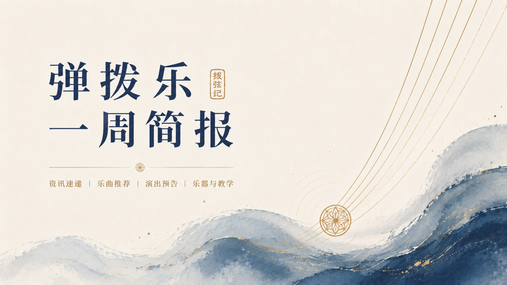

# 弹拨乐一周简报
## （2026.11.15—11.21）

## 编辑导语

> 本周国际吉他赛事密集：奥尔堡吉他节进入决赛与博览会阶段，Linares、佩斯卡拉亚得里亚、塞戈维亚三项赛事同步推进；东京国际吉他比赛已确认中国选手晋级第二轮，布鲁塞尔国际吉他节将迎来获奖者独奏会。亚洲方面，山下爱阳台北巴赫专场与Guns N’ Roses雅加达场「9 Dewa Gitar」九位印尼吉他名家同台举行。国内Gibson第5届摇滚吉他势力大赛总决赛落幕并首次纳入木吉他组；德意志留声机中国首届线下音乐节中，古筝作品进入跨文化专场。泉州南音北京高校巡演即将启幕。

---

## 近期重要演出






  
  - **🎫 {{ event.date }}｜{{ event.city }}**｜[查看详情]({{ event.link }})  
  **{{ event.title }}**
  


更多近期演出：**《拨弦记》演出情报**  
[https://boxianji.guitarkk.com/attention/](https://boxianji.guitarkk.com/attention/)

---

## **艺术节、赛事与学术动态**

- **第69届东京国际吉他比赛将于12月5–6日在东京Hakuju Hall举行。** 已确认中国选手杜可欣、杨金艳、卢轩逸晋级第二轮。

- **第15届布鲁塞尔国际吉他节与比赛将于11月27日至12月1日举行。** 中国吉他演奏家张意昂将于11月28日举行获奖者独奏会。

- **第11届保加利亚普列文国际吉他节将于11月25–30日举行。** 设15个比赛类别，11月27日安排Rovshan Mamedkuliev独奏会。

- **第29届Linares“安德烈斯·塞戈维亚”国际吉他比赛11月21日预赛、22日决赛。** 一等奖4000欧元，并获制琴师Ángel Benito定制吉他。

- **第16届亚得里亚国际吉他节11月21–22日在意大利佩斯卡拉举行。**

- **第19届希腊维里亚国际吉他节将于11月27–29日举行。** 嘉宾包括Aniello Desiderio与鲁特琴演奏家Nigel North。

- **第41届安德烈斯·塞戈维亚国际古典吉他比赛将于11月24–28日在西班牙拉埃拉杜拉举行。** 本届21名选手来自11个国家（含中国）。

- **丹麦奥尔堡国际吉他节与比赛本周末举行决赛与吉他博览会。** 11月21日举行Category I总决赛暨颁奖，博览会有丹麦、西班牙、德国、英/韩制琴师参展。

- **Gibson 2026第5届摇滚吉他势力大赛总决赛11月14–15日在北京举行。** 首次增设木吉他组。

---

## **乐器制作、非遗与文化动态**

- **泉州南音《古弦新鸣》北京高校巡演将于11月23–25日举行。** 中央音乐学院（23日）、中国音乐学院（24日）、北京师范大学（25日）。

- **深圳APEC期间，东莞松山湖品牌LiberLive无弦吉他成为外宾休息室与新闻中心高频体验产品。** 墨西哥总统辛鲍姆现场弹奏《茉莉花》。

---

## **行业动态**

- **德意志留声机中国与广州星海音乐厅首届DG Music Festival于11月15–18日举行。** 这是DG近130年历史上首次正式线下音乐节。11月17日跨文化专场中，央央演奏古筝原创《天姥吟》及Einaudi《Nuvole Bianche》改编。

- **国内吉他竞赛体系继续扩容。** Gibson大赛首次正式纳入木吉他组别。

---

## **人物资讯**

- **Guns N’ Roses于11月21日在雅加达举行世界巡演场次，特别开场阵容为「9 Dewa Gitar」。** 汇集Ian Antono、Rhoma Irama、Dewa Budjana、Eet Sjahranie等九位不同世代印尼吉他名家同台。

- **山下爱阳于11月21日在台北国家两厅院演奏厅举行《献给巴赫的礼赞》独奏会。** 曲目以巴赫鲁特琴与小提琴作品为核心。

- **琵琶演奏家于源春11月21日与台北市立国乐团合作演出香港作曲家伍卓贤《唐響》琵琶协奏曲。** 同场还有陈其钢《逝去的时光》二胡与国乐团版世界首演。

- **古筝演奏家程皓如11月22日在济南山东剧院举行“山高水长”古筝交响专场。** 含全球首演新作《万山如故》。

- **李晖与琵琶舞室内乐团《海上雅乐·琶音诗话》将于11月28日在上海东方艺术中心演奏厅举行。** 含三首世界首演作品。

- **香港Musicus Fest闭幕音乐会将于11月28日举行，香港中乐团琵琶首席张莹参演罗耀琵琶与弦乐作品。**

- **青年琵琶演奏家高嘉临将于11月26日在北京Blue Note举行跨界音乐会。**

- **马尔钦·迪拉原定2026年12月12日阿姆斯特丹皇家音乐厅独奏会已改期至2027年4月17日。**